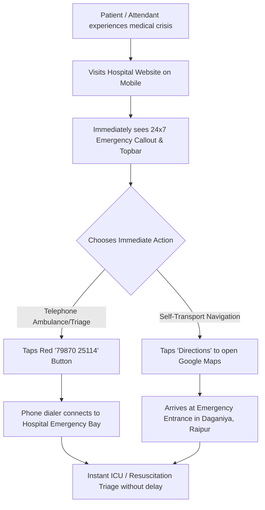
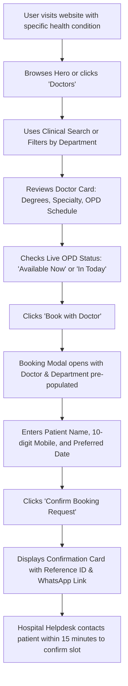
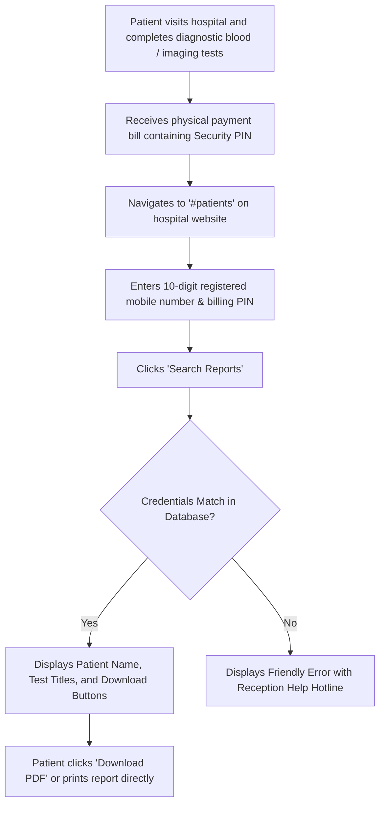

# User Journeys: Hospital Platform

This document maps out end-to-end user journeys for key clinical and administrative interactions.

---

## Journey 1: Acute Emergency Assistance (Critical Triage)

### UX Priorities:
- Zero interstitials, no pop-up cookie blockers, no registration hurdles.
- Emergency number must be tappable with single-click tel-uri protocol.

---

## Journey 2: Outpatient Doctor Discovery & Appointment Booking

### UX Priorities:
- Seamless pre-filling reduces drop-offs.
- Indian mobile validation ensures valid telephone follow-ups.

---

## Journey 3: Self-Service Diagnostic Report Retrieval

### UX Priorities:
- Zero friction, no complex passwords to remember.
- Strict two-factor validation (Mobile + Billing PIN) preserves medical confidentiality.
